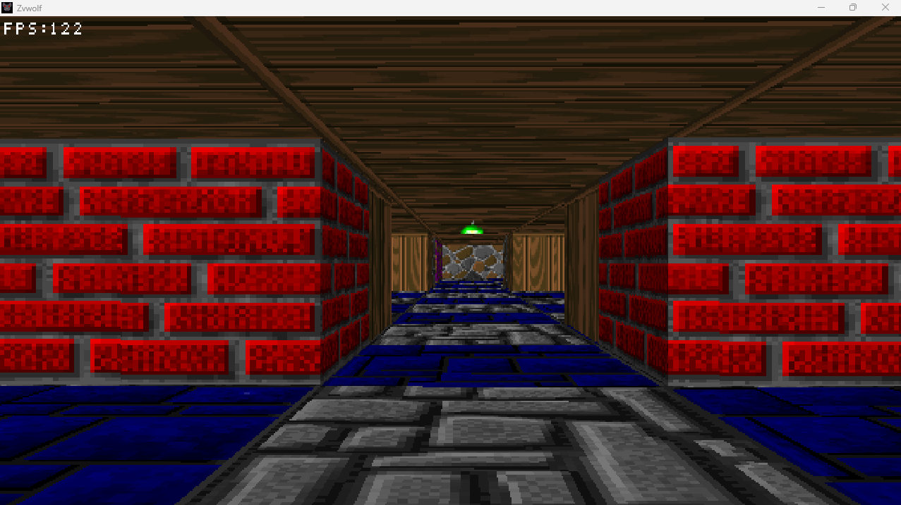
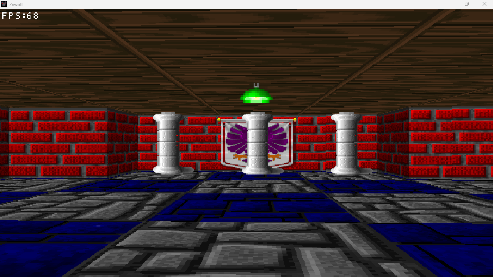

# Zvwolf

Zvwolf is a Wolfenstein inspired 2.5D raycaster written in C++, featuring textured environments, billboard sprites, mouse controlled camera movement, and a retro visual style.

## Screenshots

 | 


## Controls

`W` / `S` / `A` / `D` | Move Forward / Backward / Strafe Left / Strafe Right |
`Mouse` | Look / Turn Camera |
`ESC` | Exit Game |
`F11` | Fullscreen mode and improves performance

## Windows Installation (Release ZIP)

1. Download `zvwolf-v1.0.0-windows-release.zip` from the Releases page.
2. Extract the ZIP archive to a folder of your choice.
3. Run `zvwolf.exe`. *(Note: Keep the `assets/` and `resources/` folders in the same directory as the executable so textures and window icons load correctly.)*

## Build Instructions (From Source)

Prerequisites: **MSYS2 (UCRT64 environment)** with CMake, Ninja, and GLFW installed.

```bash
# Install dependencies in MSYS2 UCRT64 if needed
pacman -S mingw-w64-ucrt64-cmake mingw-w64-ucrt64-ninja mingw-w64-ucrt64-glfw

# Configure and build the Release version
cmake -B build -G "Ninja" -DCMAKE_BUILD_TYPE=Release
cmake --build build
```

### Future Plans
Development is ongoing!
Planned future updates include:
- Loading a configuration file
- External map loading via files rather than raw code
- Randomized map generation
- Rendering abstraction rewrite

### Thanks.